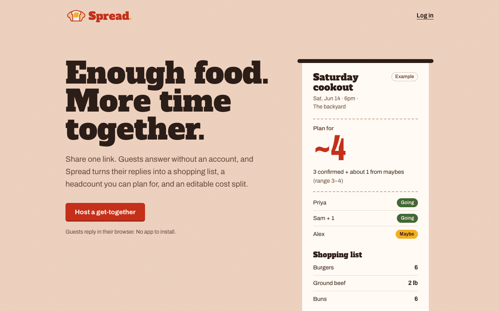
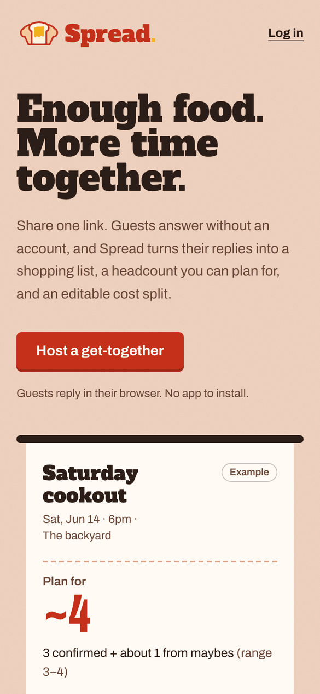

<p align="center">
  
</p>

<h1 align="center">Spread</h1>

<p align="center">
  <strong>Enough food. More time together.</strong><br>
  A phone-first planner for backyard get-togethers.<br>
  <a href="https://spreadparty.vercel.app">spreadparty.vercel.app</a>
</p>

<p align="center">
  
  &nbsp;
  
</p>

A host makes an event and shares one link. Guests RSVP with no account (plus-ones included). The host turns the headcount into a menu, a shopping list with quantities and costs, and a fair split with prefilled Venmo links.

## Features

- **One link, no guest accounts.** Guests answer in their browser; hosts track who hasn't replied and copy personal reminders.
- **A headcount you can plan for.** Confirmed guests plus plus-ones, plus the share of maybes you choose.
- **Menu from a recipe box.** 29 starter dishes across six sections, scaled per serving to the headcount.
- **Shopping list in whole packs.** Quantities round up to what the store sells, with costs and purchased tracking.
- **Fair split.** Editable shares and prefilled Venmo links the host sends themselves.
- **Try a different crowd.** Explore quantities and costs for another headcount without touching saved RSVPs.
- **Kitchen sheet.** A host-only prep and shopping view you can copy or print.

## Stack

Next.js (App Router) · TypeScript · Tailwind CSS 4 · Drizzle ORM on Postgres (Neon in production, embedded PGlite locally) · Better Auth · Vitest and Playwright · deployed on Vercel.

## Planning a real event

Copy the invitation inside your event, then paste it into your usual chat. Add the names you invited on the Guests tab to track unanswered invitations. Each unanswered name has a personal reminder you can copy and send yourself; Spread does not send email or SMS. Name matching uses spelling, so a guest who answers under a different name may still appear as unanswered.

The planning headcount includes confirmed guests, their plus-ones and the percentage of maybes you choose. People who have not replied are not counted. Menu shows prep quantities from the saved portions; Shopping rounds those quantities up to whole packs. Food notes remain visible on Guests, Menu and Shopping, but do not automatically substitute ingredients or change portions.

When required buy quantities grow after you mark an item as purchased, Shopping asks you to recheck it and review its price. Recorded actual expenses stay intact. Shopping and Split label the total provisional until those items are rechecked. Existing purchased items from before quantity tracking need a one-time recheck.

Shared Venmo links remember the amount they contained. If the split changes, the row prompts you to send an updated link. Recorded paid flags remain manual history; if a paid share changes, reconcile the payment before collecting again. Full-share links are hidden while Paid is checked. Clear it only if the full current share is still due.

## Local development

```bash
npm install
npm run dev
```

Open http://localhost:3000. No environment variables are needed: without `DATABASE_URL` the app uses an embedded [PGlite](https://pglite.dev) database stored in `.data/pglite` (git-ignored), runs the migrations on boot, and falls back to a development-only auth secret. Delete `.data/` to start fresh.

## Built-in recipes

The recipe box ships with 29 starter dishes in six sections: Grill, Tacos & handhelds, Sides & salads, Desserts, Drinks and Brunch. On the Menu tab, search by name or filter by section, then add a dish.

Every ingredient stores an amount per serving plus the store package it comes in, so the shopping list scales with the headcount: servings are rounded up, amounts multiply, and purchases round up to whole packs. For example, at four people Burgers needs 2 lb of beef, one pack of buns and two jalapeños; Iced tea needs one box of tea bags for eight glasses.

Starters are global and read-only. Editing one creates a copy owned by the host, so a past event never changes. `seedStarterRecipes` upserts the starter rows, so a corrected quantity or price in `src/domain/recipes/` reaches an existing database on the next boot.

## Environment variables

Copy `.env.example` to `.env.local` when you need them.

| Variable | Purpose |
| --- | --- |
| `DATABASE_URL` | Postgres connection string. Required in production (the app refuses to start on PGlite there). When unset in development, PGlite in `.data/pglite` is used. Pooled connection strings work: prepared statements are off. |
| `DATABASE_URL_UNPOOLED` | Optional. Direct (non-pooled) connection string, used only by `npm run db:migrate`; falls back to `DATABASE_URL`. `neon env pull` / `neon deploy` write both into `.env.local`. |
| `DATABASE_POOL_MAX` | Optional. Connections each server instance may hold, a whole number from 1 to 10. Defaults to 1 in production and on Vercel (one per serverless instance) and 5 in development. |
| `PGLITE_DATA_DIR` | Optional. Folder for the embedded PGlite database when `DATABASE_URL` is unset (default `.data/pglite`). Setting it explicitly also allows PGlite in production; the e2e run uses it for a throwaway database. |
| `BETTER_AUTH_SECRET` | Signs host sessions. Required in production; use a long random string, e.g. `openssl rand -base64 32`. |
| `BETTER_AUTH_URL` | Public origin of the app (`http://localhost:3000` locally, `https://your-domain.com` in production). Also used to build the guest share links; when unset it is derived from the request. |

## Database

With `DATABASE_URL` set, the app does not create tables itself. Run the migrations first:

```bash
npm run db:migrate   # reads .env.local; uses DATABASE_URL_UNPOOLED, else DATABASE_URL
```

Migrations need a direct connection, not a transaction pooler. You can also pass one inline: `DATABASE_URL_UNPOOLED=postgres://... npm run db:migrate`.

### Neon

The project is linked to Neon (`neon.ts`, `.neon`). `.env.local` holds the **dev** branch's `DATABASE_URL` (pooled, for the app) and `DATABASE_URL_UNPOOLED` (direct, for migrations), written by `neon checkout dev --create`. The `dev` branch has no expiry (cleared with `neon branches set-expiration dev`); other new branches expire after 7 days (see `neon.ts`). Reset it to production's current schema and data with `neon branches reset dev --parent`. Next loads `.env.local` for `npm run dev`, so never `neon checkout production` locally unless you mean to work on live data.

Migrate production (Vercel runs no migrations) whenever a deploy adds files to `drizzle/`, before or right after pushing:

```bash
DATABASE_URL_UNPOOLED="$(neon connection-string production)" npm run db:migrate
```

After changing `src/db/schema.ts`, run `npm run db:generate` and commit the new files in `drizzle/`.

## Tests

```bash
npm test          # unit and component tests (Vitest)
npm run lint
npm run typecheck # generates Next route types, then tsc
npm run e2e       # end-to-end flow (Playwright, mobile viewport)
```

The first time, install the browser with `npm run e2e:install`. `npm run e2e` builds the app and starts it on port 3100 with a fresh throwaway PGlite database in `.data/e2e-pglite` (wiped before each run, so your dev data is never touched), then walks through sign-up, RSVP, menu, shopping, split, and a changed RSVP.

## Deploying to Vercel

1. Create a Postgres database on [Neon](https://neon.tech) or [Supabase](https://supabase.com) and copy its connection string. Neon's pooled connection string and Supabase's transaction pooler (port 6543) both work: the app turns prepared statements off and keeps one connection per serverless instance (`DATABASE_POOL_MAX` changes that). For the one-off `db:migrate` run, prefer a direct or session connection (Supabase port 5432) since migrations are not meant for a transaction pooler.
2. Create the tables from your machine:
   ```bash
   DATABASE_URL="<connection string>" npm run db:migrate
   ```
3. Import the repository into Vercel (the Next.js preset needs no changes).
4. In Project Settings, Environment Variables, add `DATABASE_URL`, `BETTER_AUTH_SECRET` (a long random string), and `BETTER_AUTH_URL` (your production origin, e.g. `https://spread.example.com`, with no trailing slash).
5. Deploy. The first request seeds the starter recipes. Re-run `npm run db:migrate` against the database whenever a deploy adds a migration.

The live deployment is Vercel project `cookout` (https://spreadparty.vercel.app; the old https://cookout-lac.vercel.app 308-redirects there), connected to this repo: every push to `main` deploys to production. Its production env vars are `DATABASE_URL` (Neon production, pooled), `DATABASE_POOL_MAX=1`, `BETTER_AUTH_SECRET` and `BETTER_AUTH_URL=https://spreadparty.vercel.app`. Preview deployments have no database configured yet.

## Venmo links

Venmo has no public API, so Spread can only build prefilled Venmo pay links (`https://venmo.com/<username>?txn=pay&audience=private&amount=...&note=...`); it never sees or confirms a payment, and the host ticks "Paid" by hand.

"Send Venmo link" does not open Venmo on the host's phone. It shares (or, where the browser has no share sheet, copies) a short message such as "Hi Pat, your share of Burger Night is $12.50: <link>" so the host can send it to the guest, and only marks the guest "link sent" once the share or copy actually succeeded. A cancelled share sheet marks nothing. The small "Open link" next to it just opens the link for testing and never marks anything sent.

Venmo may change how it handles these links, so before the first real party, send the link to a second phone that has the Venmo app installed and tap it there. Confirm it opens a prefilled payment screen for the host as the payee, with the right amount and note.
